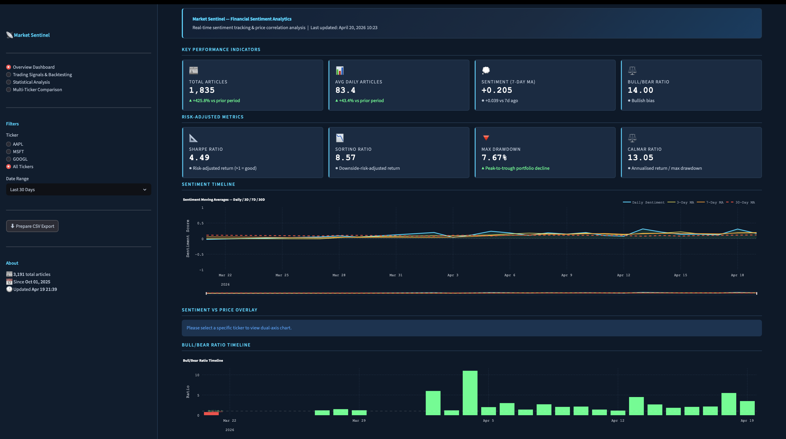
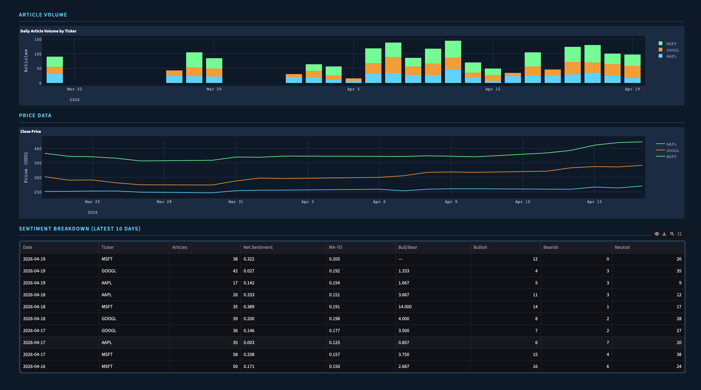
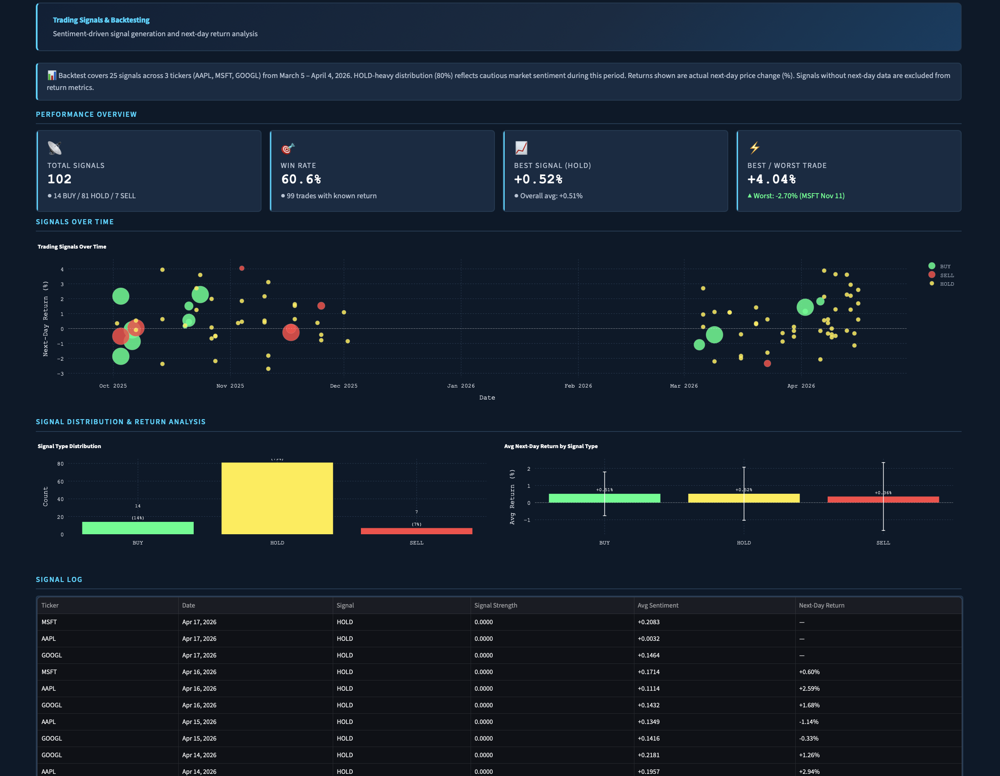
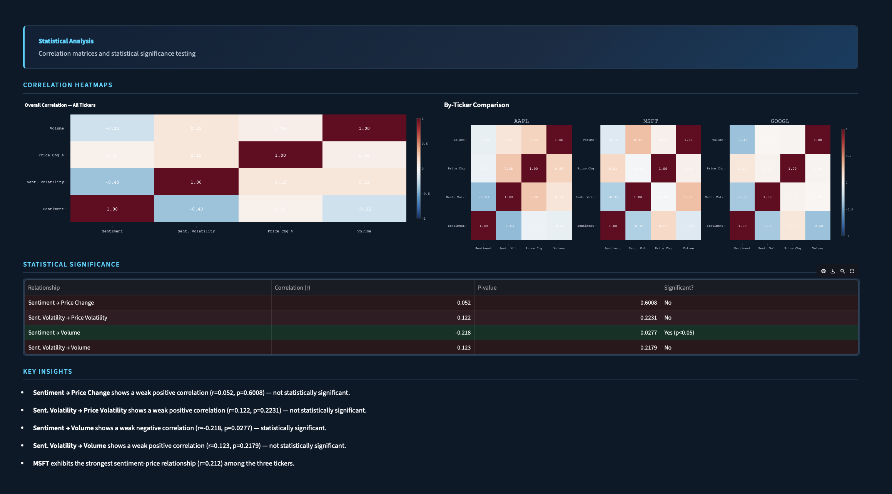
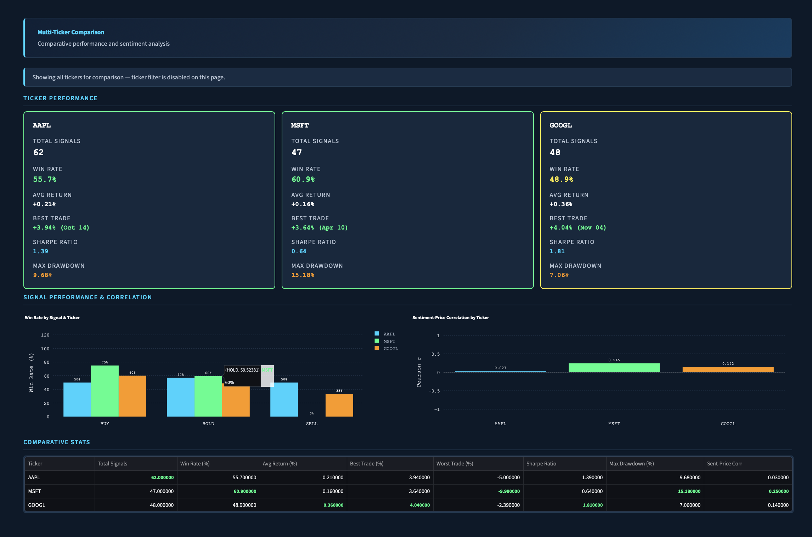

# 📊 Market Sentinel

> **Financial Data Lakehouse for Sentiment-Driven Market Analysis**

A financial data pipeline that ingests news and market data, applies FinBERT sentiment analysis, and provides exploratory analytics for AAPL, MSFT, and GOOGL.

[](https://www.python.org/downloads/)
[](https://www.docker.com/)
[](https://airflow.apache.org/)
[](https://www.postgresql.org/)
[](https://www.getdbt.com/)
[](https://market-sentinel-production.up.railway.app)

---

## 🚀 Live Demo
**Dashboard:** https://market-sentinel-production.up.railway.app

**Deployment:** Railway (the documented dataset and screenshots reflect a snapshot through April 20, 2026)

**Features:**
- FinBERT sentiment analysis on ingested financial news
- Threshold-based BUY/HOLD/SELL signal generation for exploratory analysis
- Multi-ticker comparison and correlation analysis
- Statistical heatmaps and volatility tracking

---

## 🎯 Project Overview

**Market Sentinel** is a financial analytics project for exploring how news sentiment and market indicators vary together. Its analyses are exploratory and do not establish predictive trading performance.

### The Challenge

Financial markets react to news, but there's no easy way to:
- Automate news ingestion at scale across multiple sources
- Analyze sentiment with domain-specific AI models
- Correlate sentiment patterns with actual price movements
- Visualize these relationships in real-time
- Generate actionable trading signals based on sentiment

### The Solution

Market Sentinel implements a modern **Data Lakehouse architecture** that:
- ✅ Ingests financial news daily from Alpha Vantage API (6,933 articles since October 2025)
- ✅ Stores raw data in an S3-compatible data lake (MinIO) for reprocessability
- ✅ Processes sentiment with **FinBERT** (finance-specific NLP model)
- ✅ Transforms data using **dbt** (analytics engineering best practices)
- ✅ Generates threshold-based BUY/HOLD/SELL labels for dashboard exploration
- ✅ Visualizes correlations in an interactive Streamlit dashboard

### Key Outcomes

**Technical Achievement:**
- Four Airflow DAGs orchestrate ingestion, sentiment processing, and transformation
- Eight dbt SQL models organize data into staging and analytics layers
- Docker Compose configures the local pipeline and dashboard services
- Retry handling, logging, database constraints, and dbt data-quality checks support the workflow

**Analytics:** The dashboard supports ticker comparisons, sentiment and market-indicator visualizations, correlation exploration, and inspection of generated signal labels. These views are descriptive and should not be interpreted as evidence of a trading edge.

---

## 🏆 Key Achievements

**Implementation:**
- ✅ **6,933 financial-news records** in the documented dataset snapshot
- ✅ **Four Airflow DAGs** orchestrate ingestion, sentiment processing, and dbt transformations
- ✅ **Eight dbt SQL models** with schema and data-quality tests
- ✅ **MinIO + PostgreSQL** lakehouse architecture, configured with Docker Compose
- ✅ **FinBERT inference, Streamlit analytics dashboard, and a separate exploratory backtesting script**

---

## 🏗️ Architecture

Market Sentinel implements a **Data Lakehouse** architecture, combining the flexibility of a data lake with the structure of a data warehouse.

```
┌─────────────────────────────────────────────────────────────────────────┐
│                          DATA SOURCES                                   │
├─────────────────────────────────────────────────────────────────────────┤
│  Alpha Vantage API          │         Yahoo Finance                     │
│  (News + Sentiment)         │         (Price Data)                      │
└────────────┬────────────────┴─────────────────┬─────────────────────────┘
             │                                   │
             ▼                                   ▼
┌──────────────────────────────────────────────────────────────────────────────┐
│                    ORCHESTRATION LAYER (Apache Airflow)                      │
├──────────────────────────────────────────────────────────────────────────────┤
│  DAG 1: ingest_news_dag              │  DAG 2: fetch_prices_dag              │
│  • Fetches news daily (22:00 UTC)    │  • Fetches stock prices (22:00 UTC)   │
│  • Stores raw JSON in MinIO          │  • Stores in PostgreSQL staging       │
│  • Handles API rate limits           │  • Covers AAPL, MSFT, GOOGL           │
├──────────────────────────────────────┴───────────────────────────────────────┤
│  DAG 3: process_sentiment_dag        │  DAG 4: dbt_transform_dag             │
│  • Runs FinBERT analysis (23:00 UTC) │  • Runs dbt models (23:30 UTC)        │
│  • Loads to PostgreSQL staging       |  • Builds analytics tables            │
│  • Processes new articles only       │  • Generates trading signals          │
└────────────┬─────────────────────────┴────────────────┬──────────────────────┘
             │                                          │
             ▼                                          ▼
┌─────────────────────────┐              ┌─────────────────────────────────┐
│   DATA LAKE (MinIO)     │              │  DATA WAREHOUSE (PostgreSQL)    │
├─────────────────────────┤              ├─────────────────────────────────┤
│ • Raw JSON storage      │              │  STAGING SCHEMA:                │
│ • S3-compatible API     │              │  • sentiment_logs               │
│ • Immutable archive     │              │  • price_data                   │
│ • Enables reprocessing  │              │                                 │
│                         │              │  ANALYTICS SCHEMA:              │
│ Bucket: raw-news/       │              │  • sentiment_with_prices        │
│ ├── AAPL_*.json         │──────────────│  • trading_signals              │
│ ├── MSFT_*.json         │              │  • (8 total dbt models)         │
│ └── GOOGL_*.json        │              │                                 │
└─────────────────────────┘              └─────────────┬───────────────────┘
                                                       │
                                                       ▼
                                          ┌────────────────────────────────┐
                                          │  TRANSFORMATION (dbt)          │
                                          ├────────────────────────────────┤
                                          │  • SQL-based transformations   │
                                          │  • Dependency management       │
                                          │  • Data quality tests          │
                                          │  • Version-controlled models   │
                                          └─────────────┬──────────────────┘
                                                        │
                                                        ▼
                                          ┌────────────────────────────────┐
                                          │  VISUALIZATION (Streamlit)     │
                                          ├────────────────────────────────┤
                                          │  Page 1: Overview Dashboard    │
                                          │  Page 2: Trading Signals       │
                                          │  Page 3: Statistical Analysis  │
                                          │  Page 4: Multi-Ticker Compare  │
                                          └────────────────────────────────┘
```

### Architecture Decisions

**Why Data Lakehouse?**
- **Raw data preservation:** Original JSON stored in MinIO means I can reprocess historical data with improved models without re-hitting API rate limits
- **ELT over ETL:** Extract → Load → Transform pattern enables iterative improvement of transformation logic
- **Production parity:** MinIO uses S3-compatible API (boto3), making AWS migration trivial

**Why Apache Airflow?**
- **Dependency management:** Sentiment processing DAG waits for ingestion to complete
- **Retry logic:** Automatically retries failed tasks (configured for 3 attempts)
- **Monitoring:** Built-in UI for pipeline observability
- **Industry standard:** Used by Airbnb, Spotify, Bloomberg

**Why dbt?**
- **Analytics engineering best practice:** SQL transformations as code
- **DAG compilation:** Automatically resolves model dependencies
- **Testing framework:** Data quality assertions (e.g., sentiment volatility ∈ [0,1])
- **Version control:** All transformations tracked in Git

**Why PostgreSQL over NoSQL?**
- **Structured analytics:** Time-series correlation analysis requires SQL joins
- **ACID compliance:** Ensures data integrity during concurrent writes
- **dbt compatibility:** First-class support for Postgres materialization strategies

---

## 🛠️ Tech Stack

| Layer | Technology | Purpose | Why This Choice |
|-------|-----------|---------|-----------------|
| **Orchestration** | Apache Airflow 2.10 | Workflow scheduling & dependency management | Industry standard; handles retries, monitoring, complex DAGs |
| **Containerization** | Docker + Docker Compose | Environment isolation & reproducibility | Entire stack runs with `docker-compose up`; AWS-ready |
| **Data Lake** | MinIO | S3-compatible object storage for raw JSON | Free alternative to S3; same API (boto3); production parity |
| **Data Warehouse** | PostgreSQL 16 | Relational database for structured analytics | Best open-source OLAP DB; dbt first-class support |
| **Transformation** | dbt 1.8 | SQL-based data modeling & testing | #1 tool for analytics engineering; version-controlled SQL |
| **Compute** | Python 3.10+ | ETL scripts, sentiment analysis | Data science standard; rich ecosystem (pandas, transformers) |
| **AI/NLP** | HuggingFace Transformers + FinBERT | Financial sentiment analysis | Domain-specific model trained on 1.8M financial articles |
| **Visualization** | Streamlit | Interactive analytics dashboard | Fast prototyping; Pythonic; easy deployment |
| **Data Source** | Alpha Vantage API | News articles + sentiment metadata | Free tier (25 calls/day); comprehensive financial data |
| **Price Data** | yfinance (Yahoo Finance) | Historical stock prices | Free; reliable; handles splits/dividends automatically |

---

## ✨ Key Features

### 1. **Automated Daily News Ingestion**
- Fetches financial news for AAPL, MSFT, GOOGL from Alpha Vantage API
- Handles API rate limits gracefully (25 requests/day on free tier)
- Stores raw JSON in MinIO for data lineage and reprocessability
- **Total ingested:** 6,933 articles since October 1, 2025

### 2. **AI-Powered Sentiment Analysis**
- Uses **FinBERT** (BERT fine-tuned on 1.8M financial articles) for domain-specific accuracy
- Calculates **sentiment volatility** (standard deviation of scores) to capture market uncertainty
- ✅ Processes ingested articles through scheduled Airflow DAGs
- Outputs positive/negative/neutral probabilities for each headline

### 3. **SQL-Based Data Transformations (dbt)**
- **8 SQL models** organized in staging → analytics layers
- Key models:
  - `stg_sentiment.sql`: Cleans and standardizes raw sentiment data
  - `sentiment_with_prices.sql`: Joins daily sentiment with price data
  - `trading_signals.sql`: Generates BUY/HOLD/SELL signals based on thresholds
  - `volatility_metrics.sql`: Calculates sentiment volatility metrics
  - `hourly_sentiment_agg.sql`: Hourly sentiment aggregations
- **Data quality tests:** Ensures sentiment volatility ∈ [0,1], no NULL returns, valid date ranges
- Handles weekend/holiday edge cases (maps weekend articles to next trading day)

### 4. **Threshold-Based Trading Signal Labels**
- Generates BUY/HOLD/SELL labels from sentiment and volatility thresholds
- Displays signal counts and associated next-day market data for exploratory review
- A separate script supports configurable strategy backtesting; its output depends on the selected assumptions and should not be presented as validated investment performance

### 5. **Interactive Multi-Page Dashboard**
Four comprehensive views built in Streamlit:

**Page 1: Overview Dashboard**
- Real-time KPIs: Total articles, daily average, 7-day sentiment MA, bull/bear ratio
- Risk-adjusted metrics: Sharpe Ratio, Sortino Ratio, Max Drawdown, Calmar Ratio
- Sentiment timeline with multiple moving averages (7D, 30D, 90D)
- Sentiment vs. price overlay chart (dual-axis)
- Article volume breakdown by ticker

**Page 2: Trading Signals & Backtesting**
- Signal counts and descriptive next-day return summaries
- Signal distribution analysis (BUY/HOLD/SELL breakdown)
- Historical signal table and visualizations with next-day outcomes
- Signal log table with actual next-day returns

**Page 3: Statistical Analysis**
- Overall correlation heatmap (4x4 matrix: sentiment, volatility, price, volume)
- By-ticker comparison (AAPL, MSFT, GOOGL mini-heatmaps)
- Pearson/Spearman correlation and p-value views for selected metric pairs; these are exploratory analyses
- Auto-generated key insights based on data

**Page 4: Multi-Ticker Comparison**
- Side-by-side performance cards with colored borders (includes Sharpe Ratio, Max Drawdown per ticker)
- Positive-next-day-return share by signal label (descriptive, not executed-trade win rate)
- Sentiment-price correlation bar chart
- Comparative descriptive statistics and correlation views across tickers

### 6. **Advanced Analytics**
- Descriptive return-series calculations, including Sharpe/Sortino/Calmar-style ratios and drawdown
- These figures describe this dataset and signal construction; they are not validated portfolio performance
- Exploratory Pearson correlation and p-value views for selected sentiment and market metrics
- Comparative multi-ticker risk analysis (per-ticker Sharpe and drawdown breakdown)

### 7. **Pipeline Engineering**
- **Docker Compose:** Configures the Airflow, PostgreSQL, MinIO, and Streamlit services for local use
- **Error handling:** Retry logic, graceful degradation, logging
- **Git version control:** All code, SQL models, and configurations tracked
- **Environment variables:** API keys secured via `.env` files
- **Data validation:** dbt tests prevent bad data from reaching dashboard

---

## 📊 Dataset Summary

### Data Sources
- **News Articles:** Alpha Vantage API (NEWS_SENTIMENT endpoint)
- **Price Data:** Yahoo Finance via yfinance library
- **Date Range:** October 1, 2025 - April 20, 2026 (6+ months)

### Coverage Statistics
| Metric | Value |
|--------|-------|
| **Total Articles Ingested** | 6,933 |
| **Tickers Tracked** | AAPL, MSFT, GOOGL |
| **Date Range** | Oct 1, 2025 - Apr 20, 2026 (7 months) |
| **Trading Days Covered** | ~130 (excludes weekends/holidays) |
| **Total Trading Signals** | 160 |
| **Sentiment Analyses Performed** | 6,933 |

> **Note:** December 3–31, 2025 data unavailable due to Alpha Vantage API historical retention limits.

### Sentiment Distribution
- **Overall Sentiment (7-Day MA):** +0.205 (slightly bullish)
- **Bull/Bear Ratio:** 14.00 (14:1 ratio of positive to negative articles)
- **Interpretation:** Market coverage was predominantly bullish during this period (Q4 2025 - Q1 2026), consistent with strong tech sector performance

The repository includes an exploratory strategy-analysis script. Its outputs depend on signal rules, assumptions, and the selected dataset window; they are not presented here as validated investment performance.

---

## 📊 Exploratory Analysis

The project includes scripts and dashboard views for examining sentiment, market indicators, correlations, and threshold-generated signal labels. The checked-in correlation workflow analyzes selected sentiment-to-price relationships. Results vary with the data window and sample size, so the dashboard should be treated as an exploratory analytics tool rather than evidence that sentiment predicts returns or that the signals are profitable.

The generated BUY/HOLD/SELL labels are rule-based outputs. The dashboard's positive-next-day-return percentage is a descriptive statistic over rows with known next-day returns, including HOLD labels; it is not an executed-trade win rate. For that reason, this README does not report it as strategy performance.

## 🚀 Getting Started

### Prerequisites

**Required Software:**
- Docker Desktop (≥4.0)
- Git
- 8GB+ RAM (for all containers)
- macOS, Linux, or Windows with WSL2

**API Keys (Free):**
- Alpha Vantage API key ([get here](https://www.alphavantage.co/support/#api-key))
  - Free tier: 25 API calls/day
  - Used for news ingestion

### Installation

**1. Clone the Repository**
```bash
git clone https://github.com/Brycewhi/market-sentinel.git
cd market-sentinel
```

**2. Create Environment File**
```bash
cp .env.example .env
```

Edit `.env` and add your Alpha Vantage API key:
```bash
ALPHA_VANTAGE_API_KEY=your_api_key_here
```

**3. Start the Docker Stack**
```bash
docker-compose up -d
```

This starts:
- **PostgreSQL** (port 5432): Data warehouse
- **MinIO** (ports 9000/9001): Data lake
- **Airflow Webserver** (port 8080): Orchestration UI
- **Airflow Scheduler**: Background task executor
- **Streamlit Dashboard** (port 8501): Analytics UI

**4. Initialize Airflow**

Access Airflow UI at http://localhost:8080
- **Username:** `admin`
- **Password:** `admin`

Enable DAGs (all 4):
- `ingest_news` - Daily news ingestion (22:00 UTC / 5:00 PM EST)
- `fetch_prices` - Daily price data fetch (22:00 UTC / 5:00 PM EST)
- `process_sentiment` - Sentiment analysis (23:00 UTC / 6:00 PM EST)
- `dbt_transform` - dbt model execution (23:30 UTC / 6:30 PM EST)

**5. Run Initial Backfill (Optional)**

To populate historical data:
```bash
docker exec market-sentinel-airflow-scheduler-1 \
  python /opt/airflow/scripts/backfill_news.py
```

This respects the 25 calls/day limit and tracks progress.

**6. Access the Dashboard**

Open http://localhost:8501 in your browser.

---

## 📖 Usage

### Daily Operation

Once configured, the pipeline runs automatically every day:

1. **22:00 UTC (5:00 PM EST):** `ingest_news` and `fetch_prices` DAGs run in parallel
   - News articles fetched from Alpha Vantage → stored in MinIO
   - Stock prices fetched from Yahoo Finance → stored in PostgreSQL staging
2. **23:00 UTC (6:00 PM EST):** `process_sentiment` DAG runs (depends on news ingestion)
   - FinBERT analyzes sentiment → loads to PostgreSQL staging
3. **23:30 UTC (6:30 PM EST):** `dbt_transform` DAG runs (depends on sentiment processing)
   - All 8 dbt models execute → `trading_signals` table updates
4. **Dashboard auto-refreshes:** New data appears in Streamlit UI next morning

### Manual Operations

**Trigger DAG Manually:**
1. Go to http://localhost:8080
2. Click DAG name → "Play" button

**View MinIO Data Lake:**
1. Go to http://localhost:9001
2. Login: `minioadmin` / `minioadmin`
3. Browse `raw-news` bucket

**Query Database Directly:**
```bash
docker exec -it market-sentinel-postgres-1 \
  psql -U market_sentinel -d market_sentinel

# Example queries
SELECT COUNT(*) FROM staging.sentiment_logs;
SELECT * FROM analytics.trading_signals ORDER BY signal_date DESC LIMIT 10;
```

**Run dbt Models Manually:**
```bash
docker exec market-sentinel-airflow-scheduler-1 \
  bash -c "cd /opt/airflow/dbt_market_sentinel && dbt run"
```

**Run dbt Tests:**
```bash
docker exec market-sentinel-airflow-scheduler-1 \
  bash -c "cd /opt/airflow/dbt_market_sentinel && dbt test"
```

---

## 📁 Project Structure

```
market-sentinel/
├── docker-compose.yml          # Multi-container orchestration
├── requirements.txt            # Python dependencies
├── .env.example                # Environment template
├── README.md                   # This file
│
├── dags/                       # Airflow DAGs (4 production DAGs)
│   ├── ingest_news_dag.py      # Daily news ingestion (22:00 UTC)
│   ├── fetch_prices_dag.py     # Daily price data fetch (22:00 UTC)
│   ├── process_sentiment_dag.py # Sentiment analysis (23:00 UTC)
│   └── dbt_transform_dag.py    # dbt transformations (23:30 UTC)
│
├── scripts/                    # Python ETL scripts
│   ├── fetch_news.py           # Fetch news from Alpha Vantage
│   ├── fetch_prices.py         # Yahoo Finance price data
│   ├── process_sentiment.py    # FinBERT sentiment analysis
│   ├── backfill_news.py        # Historical news backfill
│   ├── process_sentiment_backfill.py # Historical sentiment processing
│   ├── backtest_strategy.py    # Trading signal backtesting
│   ├── analyze_correlations.py # Statistical correlation analysis
│   └── check_backfill_status.py # Backfill progress tracking
│
├── dbt_market_sentinel/        # dbt project (9 models)
│   ├── models/
│   │   ├── staging/
│   │   │   └── stg_sentiment.sql          # Clean raw sentiment
│   │   └── analytics/
│   │       ├── sentiment_with_prices.sql  # Join sentiment + prices
│   │       ├── trading_signals.sql        # Generate BUY/HOLD/SELL
│   │       ├── hourly_sentiment_agg.sql   # Hourly aggregations
│   │       ├── daily_sentiment_summary.sql # Daily summaries
│   │       ├── rolling_sentiment.sql      # Rolling averages
│   │       ├── sentiment_trends.sql       # Trend analysis
│   │       ├── volatility_metrics.sql     # Volatility calculations
│   │       └── schema.yml                 # Model tests & docs
│   └── dbt_project.yml         # dbt configuration
│
├── dashboard/
│   └── app.py                  # Streamlit multi-page dashboard
│
├── screenshots/                # Dashboard screenshots for README
│   ├── page1_overview.png
│   ├── page2_signals.png
│   ├── page3_stats.png
│   └── page4_comparison.png
│
└── setup.sql                   # Database initialization schema
```

---

## 🧪 Testing

### Data Quality Tests (dbt)

**Run all tests:**
```bash
docker exec market-sentinel-airflow-scheduler-1 \
  bash -c "cd /opt/airflow/dbt_market_sentinel && dbt test"
```

**Implemented tests:**
- `trading_signals.ticker` - NOT NULL constraint
- `trading_signals.signal_date` - NOT NULL constraint
- `sentiment_with_prices.sentiment_volatility` - Value in range [0, 1]
- `sentiment_with_prices.price_change_pct` - NOT NULL for joined records

### Manual Validation

**Verify article counts:**
```sql
SELECT ticker, COUNT(*) as articles
FROM staging.sentiment_logs
GROUP BY ticker;
```

**Check signal distribution:**
```sql
SELECT signal, COUNT(*) as count
FROM analytics.trading_signals
GROUP BY signal;
```

**Validate return calculations:**
```sql
SELECT ticker, signal_date, signal, next_day_return
FROM analytics.trading_signals
WHERE ABS(next_day_return) > 5.0;  -- Flag outliers (should be empty)
```

---

## 🔧 Configuration

### Airflow DAG Parameters

**`ingest_news_dag.py`:**
- **Schedule:** `@daily` at 22:00 UTC (5:00 PM EST)
- **Retries:** 3
- **Retry delay:** 5 minutes
- **Catchup:** False (doesn't backfill missed runs)

**`fetch_prices_dag.py`:**
- **Schedule:** `@daily` at 22:00 UTC (5:00 PM EST)
- **Retries:** 3
- **Retry delay:** 5 minutes

**`process_sentiment_dag.py`:**
- **Schedule:** `@daily` at 23:00 UTC (6:00 PM EST, after news ingestion)
- **Retries:** 2
- **Timeout:** 30 minutes (for FinBERT processing)

**`dbt_transform_dag.py`:**
- **Schedule:** `@daily` at 23:30 UTC (6:30 PM EST, after sentiment processing)
- **Retries:** 2
- **Runs:** All 8 dbt models in dependency order

### dbt Materialization Strategies

- **Staging models:** `VIEW` (lightweight, always fresh)
- **Analytics models:** `TABLE` (faster queries, materialized)
- **Incremental models:** None (full refresh daily due to small data volume)

### Trading Signal Thresholds

Configured in `trading_signals.sql`:
```sql
CASE
  WHEN avg_sentiment > 0.15 AND sentiment_volatility < 0.3 THEN 'BUY'
  WHEN avg_sentiment < -0.15 AND sentiment_volatility < 0.3 THEN 'SELL'
  ELSE 'HOLD'
END as signal
```

Adjust these thresholds based on backtesting results.

---

## 📸 Dashboard Screenshots

### Overview Dashboard

*Dashboard summary metrics for the documented dataset snapshot.*

### Overview Dashboard — Volume & Price Charts

*Article volume breakdown by ticker and sentiment vs. price overlay chart*

### Trading Signals & Exploratory Analysis

*Rule-based signal labels and descriptive next-day market outcomes.*

### Statistical Analysis

*Exploratory correlations between selected sentiment and market indicators.*

### Multi-Ticker Comparison

*Side-by-side descriptive views for AAPL, MSFT, and GOOGL.*

---

## 📄 License

MIT License - See [LICENSE](LICENSE) for details.

---

**Bryce Whiteside** | Stony Brook University | Applied Mathematics & Computer Science
